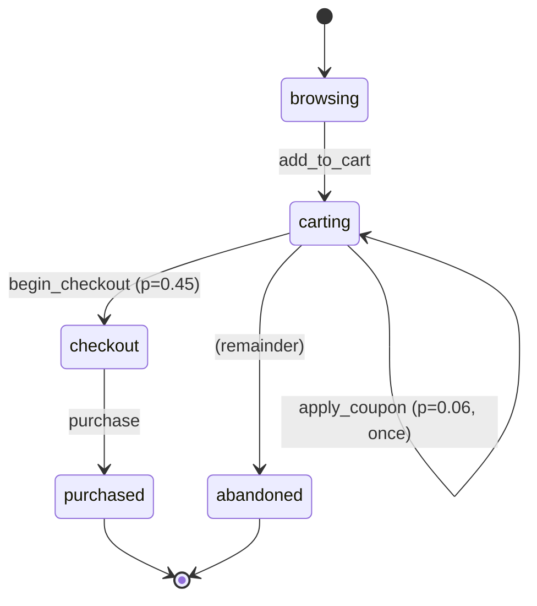

# Agent-Authored Event Simulation: Easy to Modify, Verify and Understand

Compiled 2026-10-15. Each claim carries a URL. Tags: **[P]** = traced to a primary source fetched during this research (paper abstract/HTML/PDF text, official docs, repo README); **[U]** = unverified (general knowledge, search-snippet only, a page that failed to load, or design synthesis; treat as unconfirmed).

Builds on three earlier notes, which are referenced rather than repeated:
- `event-based-systems.md` (event anatomy, point-in-time joins sec. 2.3, leakage sec. 2.5).
- `event-simulation-techniques.md` (behavioral validity sec. 1, linkage graphs sec. 4A, realism evaluation and TSTR sec. 5.5, ground-truth validation sec. 5.6, reproducibility sec. 6).
- `synthetic-data-inspection-and-validation.md` (companion, written in parallel): data-side inspection and realism metrics. This note keeps to spec/config-side verification and only summarizes data-side checks (sec. 2.5).
- `event-simulation-programmability-and-agents.md` (hereafter **PA**): configuration spectrum (PA 1.1), layered design (PA 1.4), LLM placement patterns A-E (PA 3.1), LLM-as-compiler pipeline (PA 3.2), reproducibility (PA 3.8), domain templates (PA 4), core abstractions and pack layout (PA 5.1-5.2), repo relation (PA 5.5).

Question: a human describes a platform in a few sentences ("an e-commerce site with promotions and returns"); an AI coding agent produces the configuration and/or code that simulates it. How do we build that system so the result is (1) easy to modify, (2) easy to verify, and (3) easy to understand?

---

## 0. Short answer

- **The agent edits a spec, not an engine.** PA 3.2 already argued for "LLM-as-compiler" producing config for a trusted engine. This note makes it concrete: the unit of agent work is a **domain pack** made of small, one-concept-per-file YAML documents (one file per event type, per lifecycle, per entity), validated by a JSON Schema that is *generated from Pydantic models* in a compiler. Typed Python plugins are the escape hatch. Agents edit files with ordinary coding tools and run a compiler as their check. Constrained decoding is optional, not the main safety net. See sec. 1. [U, synthesis; evidence in sec. 1.3]
- **Every configured rule compiles into a test.** The compiler emits a check suite from the spec: schema checks per event, referential checks per reference, automaton-acceptance and ordering checks per lifecycle, conservation checks per ledger, range checks per target, and a **coverage** check per transition and per linkage. Process-mining conformance (PM4Py token replay, fitness should be 1.0) and SDMetrics Diagnostic (should be 100%) act as independent second opinions. See sec. 2. [U for the design; P for the tools]
- **Every spec compiles into docs.** Docs are generated, never hand-written: an event catalog page per event, a Mermaid state diagram per lifecycle with configured probabilities and observed counts, a Mermaid ER diagram of entities and references, an event-by-entity linkage matrix, a realism scorecard (targets vs achieved), and a run manifest / data card. Generated docs are committed, so a PR diff shows the diagram change next to the YAML change. See sec. 3. [U]
- **Intent is checked by round trip, not trust.** Before the spec, the agent writes acceptance criteria from the brief. The human approves them, and they become assertions. After compilation, a *deterministic* (non-LLM) "explain" renders the spec back into prose and a `sim diff` summary. The human compares that with the brief. See sec. 2.6 and sec. 4. [U; Clover-style consistency checking is the closest precedent, P]
- **Three human checkpoints**: approve the brief and acceptance criteria; review the generated docs and diff of the spec; review the verification report of a small sample run. Production runs never call an LLM (PA 3.8). See sec. 4. [U]
- **The repo is close.** `libs/simkit` already has seeded determinism, `attach_asof` point-in-time joins, reference choosers and planted-signal scorers. `apps/datagen` has Python scenarios and `FraudConfig.validate()`. Missing pieces: a spec layer (Pydantic + YAML), an event catalog, a lifecycle engine, a check generator, and a doc generator. See sec. 6.

---

## 1. Requirement 1: easy to modify

### 1.1 Candidate representations

| Representation | Human-friendly | Agent-friendly | Static analysis (docs/tests/coverage) | Expressiveness | Source |
|---|---|---|---|---|---|
| YAML/JSON + JSON Schema | High: readable, line diffs | High: common format; schema gives editor/LLM validation | Full: the compiler sees every rule | Structure and parameters; awkward for logic | JSON Schema [P] <https://json-schema.org/overview/what-is-jsonschema> (via PA 1.2) |
| Typed Python models (Pydantic) | Medium-high for engineers | High: plain Python, type-checked | Full if the models are pure data | Same as above + validators | Pydantic emits JSON Schema Draft 2020-12 / OpenAPI 3.1 via `model_json_schema()`; descriptions from `Field(description=...)` and docstrings; `mode='validation'` vs `'serialization'` [P] <https://pydantic.dev/docs/validation/latest/concepts/json_schema/> |
| Statecharts (XState JSON-like config, SCXML) | High with a diagram | Medium-high: XState configs are JS objects with `initial`, `states`, `on`, `target`, `actions` | Full: graph traversal gives paths and coverage | Hierarchy, parallel states, guards | XState [P] <https://stately.ai/docs/xstate>; SCXML W3C Rec 1 Sep 2015: `<state>`, `<parallel>`, `<transition event cond target>`, `<datamodel>` [P] <https://www.w3.org/TR/scxml/> |
| BPMN 2.0 XML | High as a diagram, low as text | Low: verbose XML, layout info mixed in | Full | Processes, gateways | PA 1.2 [P] |
| Tracking plan (Segment/Snowplow/Avo/Ampli) | High for analysts | High | Event-level only | Events + properties, no dynamics | PA 1.2-1.3 [P] |
| General Python scenario code (repo today, Mesa, Locust) | Medium: needs reading code | High: agents write Python well | Weak: rules hidden in control flow | Unlimited | PA 1.1 L4 [P] |

Synthesis [U]: the representation that serves all three requirements is the one whose rules a compiler can *enumerate*. Enumerable rules can be turned into tests (sec. 2), docs and coverage (sec. 3). General Python code fails this: a transition hidden inside an `if` cannot be listed, drawn, or counted. So: **declarative by default, code by exception**, with every exception registered under a name the compiler can list (PA 1.4 "escape hatch" column).

### 1.2 Recommended format: Pydantic as source of truth, YAML as the editing surface

| Decision | Choice | Why |
|---|---|---|
| Schema source of truth | Pydantic models in `libs/simspec` | One definition gives runtime validation, type hints for plugins, and a generated JSON Schema for editors, CI and LLM structured output [P for Pydantic features above; U for the choice] |
| Editing surface | YAML, one concept per file | Small files give small diffs and fewer merge conflicts; agents load less context per edit. Claude Code guidance: the context window "fills up fast, and performance degrades as it fills" [P] <https://code.claude.com/docs/en/best-practices> |
| Strictness | `additionalProperties: false` (Pydantic `extra="forbid"`) everywhere | Hallucinated or misspelled keys fail loudly instead of being ignored [U]; OpenAI strict mode requires the same setting [P] <https://developers.openai.com/api/docs/guides/structured-outputs> |
| Logic | Named plugins: `policy: payments.risk_averse`, `invariant: ecommerce.no_refund_over_paid` | The compiler can still list them, and docs can show "custom code here" [U] |
| Expressions | Avoid a general expression language at first; use enumerated guard forms (`attr_in`, `ledger_ge`, `after_event`) | Every new expression language is a DSL the model has seen little of (sec. 1.3) [U] |
| Provenance | Every file carries an optional `source:` (URL, brief section, or `assumed`) next to magic numbers | Reviewers see which numbers are grounded; the scorecard can list "assumed" numbers [U] |

### 1.3 Evidence: LLMs generating DSL/config vs code

| Finding | Implication for us | Source |
|---|---|---|
| Grammar-constrained decoding makes models emit correctly structured output without fine-tuning and sometimes beats task-finetuned models on IE/parsing | Structure can be enforced mechanically | [P] <https://arxiv.org/abs/2305.13971> |
| **Grammar prompting**: give a small BNF grammar per example, have the model predict the grammar then the output; competitive on SMCalFlow, Overnight, GeoQuery, PDDL, SMILES | If we add a DSL, ship its grammar/schema in the agent context (skill file) | [P] <https://arxiv.org/abs/2305.19234> |
| Format restrictions (JSON/XML) cause "a significant decline in LLMs reasoning abilities", stricter formats hurt more | Let the agent reason in free text or code, *then* emit or edit the structured file; do not force the whole design into one constrained JSON call | [P] <https://arxiv.org/abs/2408.02442> |
| JSONSchemaBench: 10K real schemas; Guidance, Outlines, llama.cpp, XGrammar, OpenAI, Gemini differ in coverage, efficiency and quality | Provider-side schema enforcement is uneven; keep our own validator authoritative | [P] <https://arxiv.org/abs/2501.10868> |
| Provider subsets differ: OpenAI strict mode supports `minimum`/`maximum`, `pattern`, `$ref`/recursion but not `allOf`/`not`/`if`/`then`/`else`; limits of 5,000 properties, 10 nesting levels, 1,000 enum values. Anthropic strict mode does not support `minimum`/`maximum` or recursive schemas (PA 3.2) | A schema that uses composition or numeric bounds cannot be sent to every provider as-is; semantic rules belong in the compiler | [P] <https://developers.openai.com/api/docs/guides/structured-outputs>; PA 3.2 [P] |
| Survey of 111 papers: LLMs struggle with low-resource languages and DSLs because of little training data; no common benchmark | Prefer formats models have seen a lot (YAML, JSON Schema, Python, Mermaid) over a new bespoke DSL | [P] <https://arxiv.org/abs/2410.03981> |
| Anthropic tool design: keep formats "close to what the model has seen naturally occurring in text on the internet"; "poka-yoke" arguments so mistakes are hard | Same argument for spec design: familiar formats, enumerated choices | [P] <https://www.anthropic.com/engineering/building-effective-agents> |
| LLMs as config validators (Ciri, 8 LLMs, 10 systems): promising but miss some misconfiguration types and are biased toward popular parameters | Do not use an LLM as the validator of record; use it as an extra reviewer | [P] <https://arxiv.org/abs/2310.09690> |
| Code-generated simulations: ODD-to-Python study found behaviorally faithful implementations "achievable but not guaranteed" (PA 3.2) | Generate config for a trusted engine, and test outputs statistically | PA 3.2 [P] |

### 1.4 How agentic coding tools work best (applied to a sim repo)

| Practice | Primary guidance | Application here |
|---|---|---|
| Give the agent a pass/fail check | "Give Claude a check it can run: tests, a build, a screenshot to compare"; without one, "looks done" is the only signal [P] <https://code.claude.com/docs/en/best-practices> | `datagen validate` (compile + schema + semantic) and `datagen verify --sample` are the checks; wire them as a Stop hook so a turn cannot end red [U for wiring] |
| Short project memory file | CLAUDE.md: "keep it short and human-readable"; include commands Claude can't guess and project gotchas; exclude file-by-file descriptions; bloated files get ignored [P] same URL. AGENTS.md: open format, "nearest file in the directory tree" wins, read by Codex, Jules, Cursor, Copilot agent, Aider and others [P] <https://agents.md/> | Root AGENTS.md with commands; `packs/AGENTS.md` with pack rules ("one event per file", "never edit `generated/`", "every number needs `source:`") [U] |
| On-demand knowledge as skills | Skills load "on demand without bloating every conversation" [P] code.claude.com URL | Skill `author-pack` (spec reference, grammar, worked example); skill `add-event` (checklist) [U] |
| Explore, plan, implement, commit; interview for a spec | Plan mode; for larger features "have Claude interview you" and write SPEC.md; good specs name files, out-of-scope items and an end-to-end verification step [P] code.claude.com URL | The brief-to-acceptance-criteria step in sec. 4 is this interview [U] |
| Fresh-context review | Writer/Reviewer sessions; a subagent sees "only the diff and the criteria"; warn reviewers to flag only gaps that affect correctness to avoid over-engineering [P] code.claude.com URL | A reviewer agent checks the spec diff against the acceptance criteria [U] |
| Hooks for must-always rules | Hooks are "deterministic and guarantee the action happens", unlike advisory CLAUDE.md [P] code.claude.com URL | Hook regenerates docs and runs `validate` after edits under `packs/` [U] |
| Repository as the system of record; mechanical enforcement | OpenAI "harness engineering" post (AGENTS.md as a short map into `docs/`, architecture enforced by linters/structural tests) [U] <https://openai.com/index/harness-engineering/> returned 403; not verified | Structural tests: every event file is referenced by some lifecycle or marked `standalone: true` [U] |
| Spec-driven development | GitHub Spec Kit: constitution, specify, plan, tasks, implement; "Define what and why before deciding how to build it" [P] <https://github.com/github/spec-kit> | Brief (what/why) is separate from pack (how); both live in git [U] |

### 1.5 Modularity, composition, overlays

| Mechanism | Prior art | Use in packs |
|---|---|---|
| Domain packs (plugins) | PA 5.2 [U]; repo `SCENARIOS` registry | `packs/ecommerce`, `packs/payments`; registered by entry point |
| Base + overlay patches | Kustomize: "A base has no knowledge of the overlays that refer to it"; strategic-merge or JSON 6902 patches; "template-free" [P] <https://kubectl.docs.kubernetes.io/references/kustomize/glossary/> | `packs/ecommerce` is the base; `variants/ecommerce-marketplace/overlay.yaml` patches weights, adds sellers. No templating; patches are themselves validated after merge [U] |
| Shared fragments | JSON Schema `$ref`/`$defs` [U general knowledge] | Common property sets (money, address, device context) referenced from event files [U] |
| Event versioning | Snowplow `vendor/name/format/version` with SchemaVer `1-0-0` (PA 1.2) [P]; SchemaVer rules page failed (redirect loop) [U] <https://docs.snowplow.io/docs/api-reference/iglu/common-architecture/schemaver/>; Confluent compatibility modes: BACKWARD (default), FORWARD, FULL, `*_TRANSITIVE`, NONE [P] <https://docs.confluent.io/platform/current/schema-registry/fundamentals/schema-evolution.html> | Each event file has `version`; `datagen diff` classifies a change as additive (new optional property), revision, or breaking (removed/renamed/required). Breaking changes need an explicit version bump [U] |
| Pack versioning | Semver [U] | `pack.yaml: version`; manifest records the pack hash so data can be traced to an exact spec [U] |

### 1.6 Failure modes when LLMs edit config, and the guard for each

| Failure mode | Example | Guard (sec. 2 check) |
|---|---|---|
| Hallucinated / misspelled key silently ignored | `wieght: 0.3` | `extra="forbid"` schema error |
| Dangling reference | Transition emits `apply_coupon` but no event file exists | Compiler cross-reference pass |
| Orphan definition | Event file exists but nothing emits it | Structural test + coverage report shows 0 |
| Probabilities don't sum to 1 / unreachable state | Edited one branch weight only | Compiler: per-state normalization rule (explicit `remainder: true` branch) and reachability analysis |
| **Silent semantic drift** | Two LLM-generated SimPy models of the same factory gave 23 vs 21 finished products because one modeled AGVs without "sufficiently defined states and constraints" [P] <https://www.sne-journal.org/fileadmin/user_upload_sne/SNE_Issues_OA/SNE_36_1/articles/sne.36.1.10762.tn.OA.pdf> | Target ranges + snapshot of key statistics; diff of the statistical snapshot shown in PR |
| Over-broad edit | Agent "tidies" unrelated lifecycles | Spec diff summary lists every touched rule; reviewer agent checks scope against criteria |
| Schema drift / breaking change | Required property renamed | `datagen diff` compatibility classification |
| Ungrounded numbers | `conversion: 0.35` with no source | `source:` field; scorecard lists `assumed` values |
| Popular-default bias | Model fills typical-looking values | Ciri evidence [P] <https://arxiv.org/abs/2310.09690>; calibrate against reference stats (PA 3.4) |
| Long-context loss of focus | Monolithic LLM lost focus and needed many manual correction loops; effort "merely shifted from model creation to code validation" [P] SNE PDF above | Small files, narrow tasks, separate validator role |
| RNG perturbation | Adding an event shifts every random draw, so all snapshots change | Per-component RNG streams keyed by stable names (sec. 5.4) |

---

## 2. Requirement 2: easy to verify

### 2.1 Verification layers

| Layer | What it proves | Tooling options | Source |
|---|---|---|---|
| V0 Spec validation | The pack is well-formed and internally consistent | Pydantic + compiler semantic pass | [P] Pydantic URL above; checklist PA 3.2 |
| V1 Event schema | Each emitted row matches its event schema | JSON Schema; Pandera `DataFrameModel` (Polars backend supported; lazy mode collects all failures) | [P] <https://pandera.readthedocs.io/en/stable/> |
| V2 Table rules | Uniqueness, not-null, accepted values, referential integrity | dbt generic tests `unique`, `not_null`, `accepted_values`, `relationships`; a test is a query returning failing rows, "if the test returns zero rows, your assertion passes"; SodaCL YAML checks (`missing_count`, `duplicate_count`, `values in (...) must exist in ...`); Great Expectations Expectation Suites ("a verifiable assertion about data") | [P] <https://docs.getdbt.com/docs/build/data-tests>, <https://docs.soda.io/soda-cl/soda-cl-overview.html>, <https://docs.greatexpectations.io/docs/reference/learn/terms/expectation> |
| V3 Sequence / temporal invariants | Per-object event order obeys the lifecycle; timing bounds | Automaton acceptance per object; LTL on finite traces (LTLf). LTLf has the expressive power of first-order logic over finite traces and of **star-free regular expressions**, and is used in declarative business-process specification | [P] De Giacomo & Vardi, IJCAI 2013 <https://www.ijcai.org/Proceedings/13/Papers/132.pdf> (PDF text extracted) |
| V4 Conservation / state invariants | Ledgers balance; no refund > paid; inventory >= 0 | Per-entity sequential scan; Hypothesis stateful tests on the engine | Hypothesis `RuleBasedStateMachine`, `@rule`, `@precondition`, `@invariant` "run after every step"; failure prints "a very short program" reproducing it [P] <https://hypothesis.readthedocs.io/en/latest/stateful.html> |
| V5 Point-in-time correctness | No attribute or label visible before its effective time | as-of join contract (`event-based-systems.md` sec. 2.3, 2.5); repo `attach_asof` | [P] via earlier notes |
| V6 Process conformance | Generated logs fit the configured process model | PM4Py `fitness_token_based_replay`, `fitness_alignments`, `precision_*`, `conformance_diagnostics_*`; eventually-/directly-follows filters | [P] <https://pm4py-source.readthedocs.io/en/stable/_modules/pm4py/conformance.html>, <https://pm4py-source.readthedocs.io/en/latest/_modules/pm4py/filtering.html> |
| V7 Statistical fidelity (summary; details in `synthetic-data-inspection-and-validation.md`) | Configured targets are met | SDMetrics Diagnostic Report (Data Validity, Data Structure, Relationship Validity, Constraint Validity; "should be 100%") as a structural second opinion; Quality Report and other realism metrics per the companion note; TSTR (techniques doc sec. 5.5) | [P] <https://docs.sdv.dev/sdmetrics/reports/diagnostic-report>, <https://docs.sdv.dev/sdmetrics/reports/quality-report> |
| V8 Planted-signal recovery | Labels are learnable at the intended strength, not trivially | Repo scorer + bench (techniques doc sec. 5.6, 7) | [P] via earlier notes |
| V9 Regression | Same seed + same pack gives same output; changes are visible | Determinism test (repo has it); syrupy snapshots of a stats summary (`__snapshots__/`, `--snapshot-update`, fails on missing snapshot) | [P] <https://github.com/syrupy-project/syrupy> |

### 2.2 Process-mining conformance, concretely

- Token-based replay counts produced (p), consumed (c), missing (m) and remaining (r) tokens; trace fitness f = 1/2 (1 - m/c) + 1/2 (1 - r/p); log fitness uses summed counts. Alignments are optimal but scale poorly; improved token replay in PM4Py averaged ~55x faster than alignments on real logs (>20x on recent BPI logs), but the two fitness values are not directly comparable. [P] <https://ar5iv.labs.arxiv.org/html/2007.14237>
- Use [U]: the compiler exports each lifecycle as a Petri net (or process tree). Generated logs should give **fitness = 1.0** against their own model; anything lower means the engine emitted an illegal sequence. **Precision** below expectation means the configured model allows behavior that the sample never produced, which is a coverage signal (sec. 3.3).
- Against a *reference* model discovered from real logs (PA 4 domain templates, techniques doc sec. 0 "process-mining playout"), fitness/precision measure realism of control flow rather than correctness. [U]

### 2.3 Auto-generating assertions from the spec: every rule has a test

| Spec element | Generated check(s) | Layer |
|---|---|---|
| `events/<name>.yaml` properties, types, enums, required | Pandera model per event; JSON Schema validation of a sample of rows | V1 |
| `references:` (event -> entity, entity -> entity) | `relationships`-style query: zero orphan IDs; referenced entity created before event time | V2, V5 |
| `id` / unique keys | `unique`, `not_null` | V2 |
| Lifecycle transitions | Per-object trace accepted by the lifecycle automaton; no event after a terminal state; timestamps non-decreasing | V3 |
| Transition `delay:` bounds | Gap between consecutive events within bounds (quantile check) | V3 |
| Temporal constraints (`must_precede`, `within`) | LTLf / regex-over-events check, e.g. `purchase` only after `begin_checkout`; `refund` within 90 d of `purchase` | V3 |
| `ledgers:` conservation rules | Sequential balance replay per entity; final balances = sum of deltas; non-negativity | V4 |
| Attribute `volatility` / as-of | No event sees an attribute value whose `valid_from` is after the event time | V5 |
| Each lifecycle | PM4Py replay fitness == 1.0 | V6 |
| `targets:` (rates, shares, quantiles) | Achieved value within `[lo, hi]` on the sample; reported with CI | V7 |
| Each transition / linkage | Exercised count > 0 in the coverage run (or `expected_rare: true` with minimum N) | Coverage (sec. 3.3) |
| `scenarios:` planted signals | Label rate within target; AUC of a reference model within `[lo, hi]` | V8 |
| Whole pack | Determinism (two runs, same hash); statistics snapshot | V9 |

Design notes [U]:
- Generated checks live in `generated/<pack>/checks/` and are **regenerated, not edited**. Hand-written checks go in `packs/<pack>/checks/` and are additive.
- A check manifest maps each check ID to the spec rule it came from (`events/apply_coupon.yaml#/properties/coupon_code`). The verification report then says *which rule* failed, in spec terms.
- The compiler fails if any rule has no generated check (a "rule coverage" meta-test). That makes "every configured rule has a test" a CI property rather than a convention.
- Model-based test paths for the engine can be derived like XState's graph utilities: shortest paths give state coverage, simple paths give transition coverage (`getShortestPaths`, `getSimplePaths`, `createTestModel`). [P] <https://stately.ai/docs/graph>

### 2.4 Golden datasets and snapshots

- Commit a tiny golden sample per pack (e.g. 1k events, fixed seed) plus a statistics summary (counts per event type, transition matrix, target metrics). Snapshot the *summary*, not raw rows, so diffs stay readable. [U]
- Syrupy-style snapshot workflow: failure on change; `--snapshot-update` to accept; reviewer sees the summary diff in the PR. [P for tool behavior] <https://github.com/syrupy-project/syrupy>; [U for the application]
- With per-name RNG streams (sec. 5.4), adding a new event should change only the summary lines tied to it and its neighbors. A change elsewhere is a red flag. [U]

### 2.5 Data-side realism (summary only)

Scope note: data-side inspection (inspection report/dashboard, transition graph derived from output, per-event attribute reports, realism metrics such as KS, MMD, C2ST, precision/recall/coverage, power-law and graph metrics, inconsistency detection) is covered in depth in the companion note `synthetic-data-inspection-and-validation.md`. This note covers only how the spec connects to those checks:

- Each entry in `targets.yaml` (with its `source:`) compiles into one V7 check. The metric implementations come from the data-side toolkit. [U]
- Targets without a reference source are marked `assumed`, and the scorecard shows realism as "unanchored" rather than as a pass. A sim that passes only its own assumptions is not shown to be realistic. [U]
- SDMetrics Quality only looks at patterns of up to 2 columns [P] <https://docs.sdv.dev/sdmetrics/reports/quality-report>. Sequence and graph statistics need the domain-specific checks described in the companion note. [U]

### 2.6 Did the agent build what the human meant?

| Technique | How | Source |
|---|---|---|
| Acceptance criteria first | The agent interviews the human and writes `brief.md` with numbered, testable criteria ("~3% of sessions apply a coupon", "coupons only at checkout"). The human approves before any spec edit. Criteria compile into `targets`/temporal constraints | Interview-then-spec practice [P] <https://code.claude.com/docs/en/best-practices>; requirement-elicitor agent that summarizes and gets user confirmation before generation [P] SNE PDF above |
| Deterministic round-trip explain | `datagen explain` renders the compiled spec into templated prose and tables (no LLM): "Event `apply_coupon` (v1-0-0) is emitted on transition `cart -> cart` with probability 0.08 ..." The human reads this against the brief | [U]; principle: a summary generated by the same LLM that wrote the spec could repeat its misreadings |
| Consistency check across artifacts | Clover checks consistency among code, docstring and formal annotations; accepted up to 87% of correct programs with no false positives on adversarial incorrect ones | [P] <https://arxiv.org/abs/2310.17807>. Analogy brief <-> spec <-> data [U] |
| Independent reviewer agent | Fresh-context subagent checks the diff against `brief.md` criteria only | [P] code.claude.com URL |
| Scenario tester role | An agent that tests the model against collected goals and sends feedback back to the generator | [P] SNE PDF above |

---

## 3. Requirement 3: easy to understand

### 3.1 Generated artifacts

| Artifact | Content | Precedent | Source |
|---|---|---|---|
| Event catalog page per event | Name, version, description, properties table, referenced entities, which transitions emit it, example payload, sample count in last run | EventCatalog (architecture graph, generated from OpenAPI/AsyncAPI/schema registries); OTel Weaver `registry generate` docs from a registry; Avo/Ampli tracking-plan docs | [P] <https://www.eventcatalog.dev/docs/development/getting-started/introduction>, <https://github.com/open-telemetry/weaver>; Avo/Ampli PA 1.2 [P] |
| Lifecycle diagram | Mermaid `stateDiagram-v2` with `[*]` start/end, labeled transitions (`event / p=0.08`), `<<choice>>` nodes, composite states | Mermaid syntax | [P] <https://mermaid.js.org/syntax/stateDiagram.html> |
| Entity-relationship diagram | Entities, references, cardinalities | Mermaid `erDiagram` [U, page not fetched]; SDV metadata relationships (PA 1.2) [P] | |
| Linkage matrix | Rows = event types, columns = entity types; cell = reference column + share of rows populated in last run | [U] | |
| Overview card | Counts: N event types, N entities, N lifecycles, N transitions, N references, N plugins, N targets (grounded/assumed) | [U] | |
| Realism scorecard | Per target: configured range, achieved, source, pass/fail; "unanchored" flag. Full data-side inspection dashboard: see `synthetic-data-inspection-and-validation.md` | SDMetrics reports; Mostly AI SDK HTML QA reports (fidelity + privacy) | [P] SDMetrics URLs above; <https://github.com/mostly-ai/mostlyai> |
| Coverage report | Transitions exercised / total, states reached, references populated, rules with checks | XState state/transition coverage via paths [P] <https://stately.ai/docs/graph>; PM4Py precision [P] | |
| Spec diff summary | Rules added/removed/changed, compatibility class, docs regenerated | Weaver `registry diff` [P] Weaver URL | |
| Run manifest / data card | Seed, pack hash, engine version, sizes, check results, intended use, known limitations, assumed numbers, LLM provenance | Datasheets for Datasets (motivation, composition, collection process, recommended uses) [P] <https://arxiv.org/abs/1803.09010>; Data Cards (structured summaries of origins, development, intended use; >20 deployed) [P] <https://arxiv.org/abs/2204.01075>; OpenLineage run/job/dataset + facets [P] <https://openlineage.io/docs/> | |

### 3.2 Principles [U]

- **Generated, committed, checked for freshness.** `generated/` is written only by `datagen docs`. CI fails if regenerating changes it. A PR then shows YAML diff and diagram diff together, so reviewers do not need to run anything.
- **Two overlays on one diagram**: configured (probabilities) and observed (counts from the last sample run). Edges with zero observations are styled differently. Coverage gaps then show up visually.
- **One page per question**: "what exists?" (overview card), "how does an order flow?" (lifecycle diagram), "what links to what?" (ER + linkage matrix), "is it realistic?" (scorecard), "what changed?" (spec diff).
- **Explain is templated, not generated by an LLM** (sec. 2.6). An LLM may write the prose description fields inside spec files. Those are reviewed like any other text.

### 3.3 Coverage definitions [U]

| Coverage | Definition | Target |
|---|---|---|
| Rule coverage | Spec rules with at least one generated check / total rules | 100% (CI gate) |
| State coverage | Lifecycle states reached by >= 1 object in the coverage run / total | 100% |
| Transition coverage | Transitions taken >= 1 time / total | 100%, or `expected_rare` with a min-N coverage run |
| Linkage coverage | (event type, entity type) references populated in >= x% of rows / configured references | 100% of configured |
| Scenario coverage | Planted typologies that produced >= 1 labeled case / configured | 100% |
| Model precision | PM4Py precision of sample vs configured model | Report only; low value means the configured model allows paths the sample does not show |

---

## 4. End-to-end workflow and human checkpoints

| Step | Actor | Output | Gate |
|---|---|---|---|
| 1. Brief | Human, 3-10 sentences | `briefs/<name>.md` (free text) | -- |
| 2. Interview and acceptance criteria | Agent (interview) | `brief.md` with numbered criteria, out-of-scope list, reference sources | **H1: human approves criteria** |
| 3. Draft or edit pack | Agent, using the `author-pack` skill; starts from the closest existing pack (PA 4 templates) | YAML files + optional plugins | `datagen validate` passes (agent loop; Stop hook) |
| 4. Generate docs | Tool | `generated/` docs, diagrams, explain, spec diff | Freshness check |
| 5. Spec review | Human + reviewer agent | Comments on PR | **H2: human approves spec via docs/diagrams/explain** |
| 6. Sample run | Tool | 1k-100k events, fixed seed | -- |
| 7. Verify | Tool | Verification report: checks, coverage, scorecard, snapshot diff | All hard checks green |
| 8. Iterate | Agent | Spec edits until green; each failing check points to its rule | Max N iterations, then escalate to human [U] |
| 9. Accept | Human | Merge; manifest + data card | **H3: human approves report** |
| 10. Production runs | Tool only | Full-size data; no LLM calls | Determinism, manifest |

Rationale [U]: H1 catches misread intent cheaply, before any spec exists. H2 catches structural mistakes while they are still easy to read. H3 catches statistical and semantic issues that only data reveals (the 23-vs-21 throughput case in sec. 1.6). Prompt chaining with programmatic gates between steps is the pattern Anthropic describes [P] <https://www.anthropic.com/engineering/building-effective-agents>. The five-role elicitor/planner/generator/validator/tester pipeline in Krämer & Heger is a published instance for SimPy models [P] SNE PDF above.

---

## 5. Recommended architecture

All of sec. 5 is design synthesis [U], extending PA 5.

### 5.1 Core artifacts

| Artifact | Responsibility | Inputs -> outputs |
|---|---|---|
| **Spec format** (`libs/simspec/models.py`) | Pydantic models: `Pack`, `EventType`, `EntityType`, `Reference`, `Lifecycle`, `Transition`, `Ledger`, `Target`, `Scenario`, `Run` | -> JSON Schema (`generated/schema/pack.schema.json`) |
| **Loader / overlay resolver** | Read YAML, apply `extends` + overlay patches, validate merged result | YAML files -> `Pack` object |
| **Compiler** | Semantic pass (refs, reachability, normalization, compatibility diff) and lowering to engine plan | `Pack` -> `Plan` (vectorizable tables: transition matrices, delay samplers, reference choosers) + rule manifest |
| **Runtime** | Seeded engine executing the plan; builds on simkit entities/attributes/references/as-of | `Plan`, seed -> `events.parquet`, entity tables, `golden.parquet` |
| **Check generator + verifier** | Emit checks from rule manifest (sec. 2.3); run them; PM4Py conformance; SDMetrics if reference data | `Pack` + data -> `report.json` |
| **Report / doc generator** | Catalog pages, Mermaid diagrams, linkage matrix, scorecard, coverage, explain, spec diff, data card | `Pack` + `report.json` -> `generated/<pack>/docs/` |
| **Authoring tools for the agent** | AGENTS.md, skills (`author-pack`, `add-event`), CLI commands with clear errors | -- |

### 5.2 Repo layout

```text
libs/
  simkit/                 # existing runtime primitives (unchanged API, extended)
  simspec/                # NEW: Pydantic models, loader, overlay resolver, compiler, JSON Schema export
  simverify/              # NEW: check generator, verifier, PM4Py export/conformance, scorecard
apps/
  datagen/                # CLI: validate | explain | diff | docs | run | verify | author
packs/
  AGENTS.md               # pack rules for agents
  ecommerce/
    pack.yaml             # name, version, extends, run defaults, provenance
    brief.md              # acceptance criteria (H1)
    entities/{user,session,product,cart,order,promotion}.yaml
    events/{view_item,add_to_cart,begin_checkout,purchase,...}.yaml
    lifecycles/{session,order}.yaml
    ledgers/inventory.yaml
    targets.yaml
    scenarios/promo_abuse.yaml
    plugins.py            # optional, named registrations only
    checks/               # optional hand-written checks
  payments/ ...
variants/
  ecommerce-marketplace/overlay.yaml
generated/                # written only by `datagen docs` / `datagen validate`; committed; CI freshness check
  schema/pack.schema.json
  ecommerce/{docs/, checks/, rule_manifest.json, snapshots/}
.claude/skills/{author-pack,add-event}/SKILL.md
AGENTS.md
```

### 5.3 CLI surface (each is an agent check)

| Command | Exit non-zero when |
|---|---|
| `datagen validate <pack>` | Schema or semantic error; rule without a check; stale `generated/` |
| `datagen explain <pack>` | -- (prints templated summary) |
| `datagen diff <pack> --base main` | Breaking change without version bump |
| `datagen docs <pack>` | -- (regenerates) |
| `datagen run <pack> --seed S --n N` | Runtime invariant violation |
| `datagen verify <pack> --sample` | Any hard check fails; coverage below gate; snapshot changed without update flag |

### 5.4 Reproducibility and provenance

- `seed + pack hash + engine version` reproduces output bit-for-bit (PA 3.8). LLM outputs enter only as committed files. [U]
- RNG streams keyed by stable names: NumPy guidance says children from `SeedSequence.spawn` are independent with very high probability, and for ad hoc schemes recommends combining deterministic unique IDs with the root seed as a list (`default_rng([worker_id, root_seed])` "Good"), never `root_seed + worker_id` ("UNSAFE"). [P] <https://numpy.org/doc/stable/reference/random/parallel.html>. Application [U]: derive each component's stream from `[stable_hash("lifecycle:order"), root_seed]` rather than from spawn order, so adding an event or lifecycle does not perturb existing streams (PA 1.4 rule).
- `pack.yaml: provenance` records authoring model ID, prompt/brief hash and session link; the manifest records which pack files were LLM-authored vs human-edited (from git history). [U]
- The run manifest is emitted as an OpenLineage-style run event (job = pack@version, inputs = reference data, outputs = datasets, facets = checks/scorecard) so it can feed a catalog later. [P for the model] <https://openlineage.io/docs/>; [U for the mapping]

### 5.5 Worked example: add `apply_coupon` to the e-commerce pack

Brief addition (H1): "Users can apply a coupon from a promotion while viewing their cart. About 8% of carts that reach checkout had a coupon applied. A coupon belongs to an active promotion. Purchases with a coupon carry the discount." (All numbers illustrative.)

**Spec diff** (illustrative format, not implemented):

```diff
+++ packs/ecommerce/events/apply_coupon.yaml
+name: apply_coupon
+version: 1-0-0
+description: User applies a promotion coupon to the current cart.
+references:
+  user: {entity: user}
+  session: {entity: session}
+  cart: {entity: cart}
+  promotion: {entity: promotion, must_be_active_at: event_time}
+properties:
+  coupon_code: {type: string, pattern: "^[A-Z0-9]{6,12}$"}
+  discount_pct: {type: number, min: 0.05, max: 0.5}
+source: briefs/ecommerce.md#criterion-7
```

```diff
--- packs/ecommerce/lifecycles/session.yaml
+++ packs/ecommerce/lifecycles/session.yaml
   states: [browsing, carting, checkout, purchased, abandoned]
   transitions:
     - {from: carting, to: checkout, p: 0.45, emit: begin_checkout}
+    - {from: carting, to: carting, p: 0.06, emit: apply_coupon,
+       guard: {at_most_once: true}, delay: {dist: lognormal, median_s: 40}}
-    - {from: carting, to: abandoned, p: 0.55, emit: null}
+    - {from: carting, to: abandoned, remainder: true, emit: null}
```

```diff
--- packs/ecommerce/events/purchase.yaml
+++ packs/ecommerce/events/purchase.yaml
-version: 1-1-0
+version: 1-2-0
 properties:
+  coupon_code: {type: [string, "null"], derived_from: {event: apply_coupon, same: session}}
```

```diff
--- packs/ecommerce/targets.yaml
+++ packs/ecommerce/targets.yaml
+coupon_rate_at_checkout: {metric: share_of(begin_checkout, preceded_by: apply_coupon, same: session),
+                          range: [0.06, 0.10], source: briefs/ecommerce.md#criterion-7}
```

**`datagen diff` output** (illustrative):

```text
pack ecommerce 0.4.0 -> 0.5.0 (minor)
+ event   apply_coupon 1-0-0                   (new)
~ event   purchase 1-1-0 -> 1-2-0              additive: optional property coupon_code
~ lifecycle session                            +1 transition carting->carting [apply_coupon]; abandoned now remainder
+ target  coupon_rate_at_checkout [0.06,0.10]  source: brief criterion 7
compatibility: BACKWARD-compatible (no removed/required properties)
generated: 9 new checks, 2 changed docs pages, 1 diagram
```

**Auto-generated checks** (`generated/ecommerce/checks/`, names illustrative):

| Check ID | From rule | Layer |
|---|---|---|
| `schema.apply_coupon` | `events/apply_coupon.yaml#/properties` (pattern, 0.05-0.5) | V1 |
| `ref.apply_coupon.cart` / `.promotion` / `.session` / `.user` | `#/references` | V2 |
| `asof.apply_coupon.promotion_active` | `must_be_active_at: event_time` | V5 |
| `seq.session.apply_coupon_at_most_once` | `guard.at_most_once` | V3 |
| `seq.session.apply_coupon_before_checkout` | transition source state `carting` (LTLf: `G(apply_coupon -> !purchased_before)`) | V3 |
| `derive.purchase.coupon_code_matches_session` | `derived_from` | V2 |
| `conformance.session.fitness == 1.0` | lifecycle changed | V6 |
| `target.coupon_rate_at_checkout in [0.06, 0.10]` | `targets.yaml` | V7 |
| `coverage.session.carting->carting[apply_coupon] > 0` | new transition | Coverage |

**Updated diagram** (`generated/ecommerce/docs/lifecycles/session.md`):



**Updated overview card**: event types 14 -> 15; transitions 11 -> 12; references 31 -> 35; targets 9 -> 10 (grounded 4, assumed 6). **Linkage matrix** gains a row `apply_coupon` with cells user/session/cart/promotion. **Snapshot diff** should touch only `apply_coupon` counts, `purchase.coupon_code` null share, and the abandon rate (which absorbed the 0.06). [U, all illustrative]

What the human reviews at H2: the four YAML hunks, the explain paragraph for `apply_coupon`, the diagram, and the compatibility line. At H3: the target result, coverage = 100%, fitness = 1.0, and the snapshot diff limited to the expected lines.

---

## 6. Relation to `libs/simkit` and `apps/datagen` (read-only review)

| Repo today | Role in the proposed system | Gap |
|---|---|---|
| `apps/datagen` scenarios are Python modules registered in `SCENARIOS`; `FraudConfig` is a frozen dataclass with `validate()` | Python scenarios stay valid as "code packs" (PA 5.5 step 3); `FraudConfig` becomes a Pydantic `Run`/pack-parameters model | Rules inside `fraud.py` (invites, zombie activity, transactions) are not enumerable, so no auto checks, docs or coverage for them |
| `simkit.entities` (`EntitySpec`, `build_entities`, `attach_asof`) and `attributes` (`AttrSpec`, cardinality x volatility) | Runtime targets for `entities/*.yaml`; `attach_asof` is the V5 point-in-time contract | Declarative loader; per-attribute rates |
| `simkit.references` (`RefSpec` + `uniform`/`skewed`/`hubs`) | Runtime for `references:`; the check generator gets one referential check per `RefSpec` | Achieved-statistics reporting for linkage coverage |
| Planted-signal ground truth (`scorer`, `golden.parquet`, export refuses golden columns in `events.parquet`) | V8 checks and leakage guard (V5) | Expressed as a `scenarios:` rule so it appears in docs/scorecard |
| Deterministic seeded output (tested) and `meta.json` | V9 and the run manifest | Pack hash, per-name RNG streams, provenance, data-card fields |
| No event catalog, no lifecycle engine | -- | Core new work (PA 5.5 steps 1-2) |

Suggested order [U]: (1) `simspec` models + loader that produces today's `EntitySpec`/`RefSpec` objects; (2) event catalog + check generator for V1/V2/V5 (cheap, high value); (3) doc generator (overview card, ER, catalog pages); (4) lifecycle engine + V3/V6 + Mermaid lifecycle diagrams; (5) re-express the fraud scenario as `packs/ecommerce` + `scenarios/referral_abuse.yaml` and compare statistics with today's output; (6) agent skills and `datagen author`.

---

## 7. Prior art and lessons

| Prior art | What it does | Lesson for us | Source |
|---|---|---|---|
| NVIDIA NeMo Data Designer | Config builder of columns (samplers, LLM text, seed data); "dependency-aware generation"; validators: Python, SQL, custom, LLM judges; `preview()` before large runs | Preview-then-run and validators attached to the config are the same loop as sec. 4; it is row/column oriented, not event lifecycles | [P] <https://github.com/NVIDIA-NeMo/DataDesigner>; relation to Gretel not on page [U] |
| Tonic Fabricate | Conversational agent generates referentially intact data from a description or an empty schema; drafts "a strategic generation plan" for complex schemas; a Validation Agent reviews the Data Agent's output; MCP server | Plan-before-build and a separate validator agent are converging industry patterns; no published spec format to review | [P] <https://www.tonic.ai/products/fabricate> |
| Mostly AI SDK | Trains generators on real tabular/multi-table/time-series data; fidelity and privacy metrics; HTML QA reports | Learned synthesis needs real data; its QA report is a model for our scorecard | [P] <https://github.com/mostly-ai/mostlyai> |
| SDV / SDMetrics | Metadata JSON; Quality and Diagnostic reports | Reuse reports as V7 / second opinion | PA 1.2 [P]; sec. 2.1 URLs |
| FactorSim | Natural language -> full simulation code using a factored POMDP; factorization reduces context per generation step; beats baselines on prompt alignment, zero-shot transfer, human eval | Decomposing the spec into small factors helps LLM generation, supporting one-concept-per-file | [P] <https://arxiv.org/abs/2409.17652> |
| Krämer & Heger (SNE 2026) | Five agents (elicitor, planner, code generator, code validator, scenario tester) produce SimPy models; earlier monolithic LLM "lost focus over longer contexts"; deterministic times chosen "to ensure reproducibility"; two implementations differed (23 vs 21 products) due to under-specified states | Role separation, explicit states/constraints, and statistical comparison catch semantic drift | [P] SNE PDF URL in sec. 1.6 |
| Jeong, Cho & Woo (WSC 2025 poster) | LLM + MCP-delivered structured context generates SimPy M/M/1; "some of the generated models required iterative prompting and minor corrections" | Structured context (schemas) grounds generation; still needs a fix loop | [P] <https://www.informs-sim.org/wsc25papers/pos123.pdf> (PDF text extracted) |
| Fine-tuned LLM -> structured representation -> code for a supply-chain DES engine | Intermediate structured representation before code | Same two-stage idea as spec-then-engine | [U] search snippet, MODSIM 2025 <https://mssanz.org.au/modsim2025/files/M02.chotaliya.pdf> (not fetched) |
| OTel Weaver | YAML registry: `check`, `generate` (docs/code), `diff`, `live-check`, `emit` | Closest existing "registry -> docs/tests/emitter/diff" toolchain; copy its command set | [P] <https://github.com/open-telemetry/weaver> |
| ODD-to-Python ABM study | Faithful code achievable but not guaranteed | Prefer config; test statistically | PA 3.2 [P] |
| LLM-agent social sims (OASIS, AgentSociety, etc.) | Per-step LLM agents | Not reproducible and costly; use for discovery only | PA 2.1-2.2 [P] |

---

## 8. Open questions and risks

- **Expressiveness ceiling.** Enumerated guard forms will not cover every business rule; plugins will grow. Risk: logic migrates into plugins, and docs/checks/coverage go blind. Mitigation idea: plugins must declare the events they emit and the invariants they assume, so they appear in diagrams as opaque boxes. [U]
- **Agent reliability on cross-file edits.** One concept per file means a new event touches 3-5 files. Whether agents keep them consistent without the compiler loop is untested here; the compiler is assumed to catch it. [U]
- **Constrained decoding vs reasoning.** Format restrictions can reduce reasoning quality [P] <https://arxiv.org/abs/2408.02442>. Editing YAML through a coding tool avoids one-shot constrained output but loses the guarantee of valid syntax per call. Which works better for our packs is an empirical question. [U]
- **Realism without reference data.** Checks prove the sim does what the spec says, not that the spec matches reality. An "unanchored" scorecard is honest but may be ignored. [U]
- **Test explosion and flakiness.** Statistical targets on small samples will flake; need sample-size-aware ranges (CIs) and a separate larger coverage run for rare transitions. [U]
- **Generated-file churn.** Committing `generated/` makes PRs reviewable but noisy; may need collapsed diffs or generated-file attributes in the code host. [U]
- **Explain fidelity.** A templated explain is faithful to the spec but can be dull and long; an LLM-written explain is readable but can repeat the author's misreading. A mix (templated facts, LLM prose clearly labeled) needs testing. [U]
- **Schema evolution across packs and overlays.** Overlays patching a base that changed underneath them can silently become wrong; the overlay must be re-validated after every base change, and `datagen diff` must run on resolved packs. [U]
- **Provider differences.** Structured-output subsets differ by provider (OpenAI vs Anthropic, sec. 1.3); the pack JSON Schema needs a "provider-safe" export profile if we ever use constrained decoding. [P for differences; U for the remedy]
- **Model and tool churn.** Agent skills and AGENTS.md conventions are young (AGENTS.md now stewarded under the Linux Foundation's Agentic AI Foundation [P] <https://agents.md/>); expect to revise them. [U]
- **Process-mining fit for object-centric data.** Token replay assumes one case ID per trace; e-commerce events touch user, session, cart and order at once. Object-centric process mining may be needed; not researched here. [U]

---

## Claims lacking primary sources (summary)

- All of sec. 5 (architecture, repo layout, CLI, worked example, diffs, generated checks, diagram, counts) and sec. 6 suggested order: design synthesis.
- Representation choice rationale (sec. 1.1 synthesis, sec. 1.2 decisions other than Pydantic/OpenAI features), composition mechanics (fragments via `$ref`, pack semver, compatibility classifier), and the failure-mode guards in sec. 1.6.
- Check-generation design (sec. 2.3 notes), golden-sample/snapshot application (sec. 2.4), unanchored-realism stance (sec. 2.5), deterministic round-trip explain (sec. 2.6), coverage definitions (sec. 3.3), artifact principles (sec. 3.2), linkage matrix and overview card, workflow gates and iteration limits (sec. 4).
- OpenAI "harness engineering" guidance: page returned 403; content stated from memory and not verified.
- Snowplow SchemaVer rules page: redirect loop, not fetched (SchemaVer existence is [P] via PA 1.2).
- Mermaid `erDiagram` syntax: page not fetched.
- Gretel's relation to NVIDIA Data Designer: not stated on the fetched page.
- Fine-tuned LLM supply-chain DES paper (MODSIM 2025): search snippet only.
- Datasheets for Datasets section list beyond motivation, composition, collection process and recommended uses: abstract only.
- Great Expectations Data Docs (human-readable rendering): not on the fetched page.
- XState guard syntax: not on the fetched overview page.
- Object-centric process mining: not researched.
