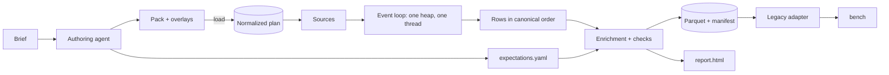

# Agentic Event Simulator: pure-Python revision

**Status:** draft, revising `2026-10-15-agentic-event-simulator-architecture.html` (final design, 2026-10-16)
**Date:** 2026-10-20
**Builds on:** the original design, the 5 research notes in `docs/research/`, and the pure-Python simulator core merged in PR #3 (`neorisk_simkit.sim`)

A repo-native library and CLI where an AI agent turns a short business brief into a simulation pack, and the engine turns that pack into realistic, checked event data. Mutable state has exactly one owner, owners and shards talk only through immutable, latency-bounded requests, and one total order drives both execution and replay. **The codebase is pure Python, and is sized for small-to-medium datasets (under 10⁵ events per run).**

## 0. What changed from the original, and why

The original design is kept: its goals, vocabulary, overlay contract, checks, output contract, schemas, replay and workflow. Two requirements are removed, and so are the mechanisms that existed only to serve them:

| Removed requirement | Mechanisms that go with it |
|---|---|
| Absolute throughput: "10⁸ events in ≤ 10 min on 16 cores / 64 GB" (01, 02, 10) | Parallel owner execution; frontier steps, rounds and the safe horizon; calendar queue; slab pools, per-step output caps and memory hard-caps; benchmark workloads with time gates; per-step file splitting and step index; sampled statistics |
| Compiled kernels (Numba) | The native ABI, the reserve vector, `RETRY`, generated emitters and dispatch modules, checked/debug compiled mode, fixed fan-out sub-steps, and checked int64 helpers |

Everything that served *modeling* is kept, even though it originally doubled as a performance device: single ownership of state, request/response with minimum latency, holds and reservations, and the five primitives. These make packs correct and readable, and they keep the realistic timing that the fraud signals depend on.

Performance is now a scaling requirement, never an absolute number (§10).

## 01 Decisions

| Area | Decision | Note |
|---|---|---|
| Form | One library (`simkit`) and one CLI (`datagen`) | Unchanged. No services, no UI, nothing over a network. Agents author in the repo; humans review PRs and one report. |
| Language | **Pure Python** (stdlib, NumPy, Polars, PyArrow) | **Changed.** No Numba, Cython, C extensions or code generation. A kernel is an ordinary Python function. |
| Scale | **Up to ~10⁵ events per run**, everything in memory | **Changed.** Larger runs are out of scope; if they become necessary, fix the algorithm first (§10). |
| Vocabulary | Five primitives: Table, Process, Action, Source, Check | Unchanged. Ledgers, handoffs, holds, concentration and overlays are standard-library recipes. |
| Boundaries | Owners and shards interact only by immutable request/response with declared minimum latency δ | Kept as a **modeling** rule. No mutable state crosses a boundary; joint constraints use holds. |
| Scheduling | **One global event heap, single-threaded** | **Changed.** Pop the earliest command and run it. No rounds, horizons or suspension bookkeeping. |
| Order | One total order for execution and replay: `(event_time, priority, seq)` | **Simplified.** `seq` is a global counter assigned at commit, so it replaces per-partition Lamport clocks. |
| Action interface | **Validate → commit** | **Simplified.** No reserve vector: nothing can run out mid-action. Rejections happen before any write. |
| Memory | Bounded by output size: O(E) | **Changed.** No slabs or caps. A `max_events` guard stops runaway packs. |

## 02 Requirements

- **Simple.** One library, one CLI, a handful of commands. Nothing calls anything over a network. A newcomer can read the engine core in one sitting (target: under 1,000 lines).
- **Expressive.** E-commerce, payments, exchanges, L1 chains and social networks fit the five primitives. A distinct user group is an overlay, not a fork.
- **Easy to modify.** Adding an event, behavior or user group is a small, local change reviewed in an ordinary PR.
- **Easy to verify.** Declared domain laws are checked on every row; realism is measured exactly over the full output (no sampling is needed at this scale).
- **Easy to understand.** One compact report: counts, linkages, transitions, concentration, rejections, cohorts, interference, checks.
- **Scales linearly.** Time is roughly linear in the number of entities and events, and memory is linear in the events emitted. This is tested as a ratio, never as an absolute time (§10).

## 03 System overview

A pack is a Python module that loads into a small normalized plan. The engine seeds sources (populations and arrivals), then runs one event loop: it pops the earliest command from a global heap and dispatches it to the action of the partition it addresses. That action reads and writes only its partition's state, emits rows, and schedules timers, requests or messages. When the heap is empty or the horizon is reached, the engine sorts the output into canonical order and runs enrichment, checks and the Parquet writer.



Everything runs in one Python process on one thread. Polars may use its own threads for post-run work; the simulation itself has none.

## 04 Vocabulary & pack API

| Primitive | Meaning | Absorbs |
|---|---|---|
| Table | Typed records with identity and references. Mutable tables hold state; append-only tables hold events and postings. | Entities, attributes, edges, accounts, tokens, events, postings |
| Process | State-bearing behavior that lives in exactly one partition: an owner (user, payment, campaign) or a shard (order book, chain, bonus pool). | Lifecycles, journeys, flows, matching engines, pools |
| Action | An all-or-nothing step over its partition's state (05). | Ledger operations, holds, handoffs, matching steps |
| Source | Populations, arrivals, exogenous timelines, graph generators, cohorts. | Clocks, distributions, scenario populations |
| Check | A declared domain law or statistical expectation evaluated on output. | Acceptance criteria, concentration targets, legality |

**Two ways to define a process** (unchanged in intent):

- **Handwritten action:** any behavior, configured by a typed dataclass. **It is now a plain Python function** (05).
- **State machine:** common behavior with no code. A table-driven **interpreter written in Python** (it was a generated dispatch module). It is still built only after two handwritten processes show the common shape.

The state-machine operations and their edge-case decisions are unchanged: `branch`, `timer`, `repeat`, `until … then`, `spawn`, `join` (with timeout, duplicate suppression and a late policy), `request` (with timeout and a mandatory rejection branch), and `then` (sequential composition of atomic actions). The example `examples/payments/specs/pack.py` from the original stays valid as written.

## 05 Action interface

Every action, built-in or custom, follows one convention: **validate, then commit**. A rejection is legal only before the first write. The engine checks this in debug mode by snapshotting the partition row and failing the run if a rejected action changed it.

```python
# examples/payments/specs/actions.py (simplified)
@action(state="payment")
def partial_refund(ctx, s, cmd):
    left = s.captured - s.refunded - s.refund_hold     # s: this partition's state row
    if left <= 0:
        return ctx.reject("nothing_refundable")          # 1. validate: no writes
    amt = min(left, ctx.rng.lognormal_minor(median=2500))
    s.refunded += amt                                    # 2. commit
    ctx.emit("refund", payment=ctx.self_id, amount=amt)
    ctx.after(DAY, "settle_refund")
    return ctx.commit()
```

**The contract**

- **No reservation step.** Output goes into growable in-memory tables, so nothing can run out mid-action. The reserve vector, `RETRY` and slab swaps are gone.
- **Keyed random streams (kept).** Each partition gets its own generator, derived from `(seed, partition, process)`. Draws therefore don't shift when unrelated partitions or overlays are added, which the overlay regression rule (08) depends on.
- **Fan-out is a loop.** An action that fills 300 orders just loops. The fixed 64-fill sub-steps and cursors existed for buffer limits and are gone. Fill-or-kill still runs a read-only preflight first.
- **Composition:** `a.then(b)` is two atomic actions; an atomic composite is one action. (Unchanged.)
- **Emitters:** `ctx.emit(event, **cols)` is checked against the declared schema at emit time in debug mode, and at the end of the run otherwise. No generated typed emitters.
- **Restricted views by convention, enforced in debug mode.** Actions receive their own partition's state; shared inputs are read-only arrays (`np.ndarray.setflags(write=False)`). A lint flags mutable module globals. Amounts are Python ints, which don't overflow, and are exported as int64 with a range check.
- **Delivery and lateness:** a timer or message addressed to a retired instance is dropped and counted as `late_messages`. (Unchanged.)

## 06 Execution model

### Partitions and boundaries (kept as modeling rules)

- Every piece of mutable state has exactly one partition: an **owner** (a user, payment or campaign) or a **shard** (an order book, chain, inventory group or bonus pool).
- Partitions interact only through **immutable messages**. An owner sends a request to a shard and waits for a response. The payload is copied, never aliased.
- Every boundary declares a **minimum latency δ > 0**, the platform's response time. Responses arrive at `t_request + latency`, with latency ≥ δ.
- **Joint constraints use holds:** the owner holds its side, the shard decides its side, then the owner commits or releases.
- **Multi-shard decisions use reservations:** reserve in each shard, join on the responses, then commit all or release all. Reservations carry a TTL.
- **Owner-to-owner messages** (for example crediting an inviter) are delivered with latency ≥ δ.
- **Creating an owner** (checkout creates a payment) is a creation message processed at its creation time.

These rules now exist for **model clarity and realistic timing**, not for parallelism. They prevent hidden coupling between actors and keep "who decided what, when" visible in the data.

### The loop

```text
heap ← initial commands from sources (arrivals, timelines)
while heap and now < horizon and emitted < max_events:
    (t, priority, seq, target, command) ← pop(heap)
    now ← t
    if target retired: count late_messages; continue
    run target's action for command        # emits rows, pushes timers/requests/messages
```

- **Waiting on a request** is a state, not a thread: the owner records that it's waiting, and the response arrives later as an ordinary command in the heap. No suspension bookkeeping and no horizons.
- **Same-time precedence** is declared as a command priority (messages before timers by default; continuations first), as in the original. For example, KYC treats redemption at exactly the expiry instant as expired.
- **Spawn bounds:** each process declares `max_spawn_depth` (default 3), and the run has a `max_events` guard. Exceeding either fails the run with a diagnostic naming the process.
- **Cost:** each command costs one heap pop plus its pushes, O(log Q) each, where Q is the number of pending commands. A run is O(E log Q) time.

### One total order

The execution key and the canonical key are the same: `(event_time, priority, seq)`. Here `seq` is a single global counter assigned at commit. Execution order and replay order are therefore identical by construction. `cause_id` records which event a command came from. Lamport clocks, partition clocks and cross-partition ordering rules are no longer needed.

### Run boundaries (unchanged)

| Mode | What is fixed | Behavior at the horizon |
|---|---|---|
| time (default) | Simulated span | Warm-up generated but not exported; opening snapshot written; open cases censored |
| population | Number of actors | Each case runs to its natural end or a maximum step count |
| event count | Never truncated | Reached approximately through arrival rates |

## 07 Worked traces

Both original traces stay valid, with the timing unchanged.

- **Recurring shopper buying two SKUs:** hold on the spending limit, `reserve(A)` and `reserve(B)`, B rejects, release, then substitute C and commit.
- **Campaign against a capped bonus pool:** the pool shard processes claims in canonical order, so the cap is exact.

The only change is in the narration. "Three rounds within a frontier step" becomes "the responses arrive as commands at `t + 0.3 s`, `t + 0.4 s`". The pool cap stays exact because a single loop processes every claim in order.

## 08 Behavior overlays

**Unchanged.** An overlay adds a configurable group of actors with distinct behavior to an existing pack without editing it, and they emit the same event schema as everyone else. The `bounty_hunters.py` example and the overlay contract table carry over as written:
- cohort size, share or rate;
- the same event schema;
- `suppress`;
- extension points;
- join with timeout;
- a campaign owner;
- a bonus pool shard;
- hidden labels with `label_available_at`;
- the regression rule.

The **regression rule** depends on the keyed random streams (05):
- If the overlay shares no decision-relevant state with the base, base rows must be identical with and without it.
- If it does share state, CI checks three things: base users' exogenous draws are identical, laws hold, and the report shows the interference.

At this scale both runs are cheap, so CI always runs both.

## 09 Domain stress tests

Unchanged as modeling cases: the order book, L1 with reverts, social graph reposts, auth/capture/refund/dispute, cross-device KYC, and multi-SKU checkout. The limits that were really performance devices are dropped:
- the 64-fill sub-steps (a loop now);
- "checked int64 or 128-bit pairs" (Python ints are exact; check the range on export);
- the per-epoch CSR graph (a plain adjacency structure is fine at under 10⁵ events).

## 10 Performance & memory

**Requirement: scaling, not speed.**

| Quantity | Requirement | How it's tested |
|---|---|---|
| Time | O(E log Q): roughly linear in events, and in entities for a fixed span | Run at N and 4N entities; assert rows grow about 4× and time grows at most about 6× (slack for log factors and noise) |
| Memory | O(E): output held in memory, plus O(live partitions) state | Same runs; assert peak memory grows at most about 4× plus a constant |
| Post-run work | Sorts, joins and rolling windows: O(E log E) | Covered by the same ratio test |

- **No absolute time or throughput gates** anywhere: no benchmarks/*.toml workloads, no "≤ 60 s".
- **When a ratio test fails, fix the algorithm** (an accidental O(n²) scan, a per-event full-table filter), not the interpreter or the hardware.
- **Practical envelope:** under 10⁵ events is the design point. Nothing in the design prevents larger runs, but nothing is optimized for them.
- **Memory model:** all rows live in per-table column lists until the run ends, then become Polars frames. The only runtime guard is `max_events`. Slabs, per-step caps, hard caps and memory estimates in `validate` are all removed.
- **Enrichment order (kept):** owner-local values attach inside actions. Cross-owner features (device-level rolling counts, invite graph features) run after the loop over the full output in canonical order, and a feature for event *e* counts only strictly earlier events.

## 11 Checks

| Group | Input | Examples |
|---|---|---|
| Structural | Full output | Types, required values, uniqueness, referential integrity, ordering keys, leakage |
| Per-partition laws | Each partition's rows in canonical order | Lifecycle legality, refunds ≤ captured, holds resolved, balances never negative, nonce sequence |
| Cross-partition laws | Full output in canonical order | Every reservation committed or released by TTL; pool grants ≤ cap; request/response pairing |
| Statistical | **Full output (exact)** | Funnels, gaps, degree, concentration, cohort shares, with confidence intervals across held-out seeds |

- **Simplified:** checks are Polars queries over the finished output, not streaming reducers carried across steps.
- **Sampling is gone:** stratified case sampling and inverse-probability weights are unnecessary at under 10⁵ events. Censoring rates are still reported for case metrics.
- **Kept:**
  - failures cite `(partition_id, seq)` and the action;
  - reference implementations for matching, the L1 envelope and holds;
  - mutation tests and forced-path fixtures;
  - required checks fail CI.

## 12 Identity & reproducibility

- **IDs are sequential per table**, assigned in commit order. They are deterministic because there is one thread. Provisional handles, prefix-sum dense indices and slot generations are removed.
- **Public IDs (optional):** a seeded permutation such as the original Feistel can be applied at export, if IDs should look random. Off by default.

| Guarantee | Mechanism | Test |
|---|---|---|
| Identical replay | Pack revision, `uv.lock`, seed and config in `manifest.json`; single-threaded loop | Byte-identical data files and manifest under a fixed writer config |
| Edit stability (best effort) | Keyed random streams per partition and process | An unrelated action leaves other rows identical; overlays follow the regression rule (08) |
| ~~Thread, slab and step invariance~~ | Removed: there are no threads, slabs or steps | — |

## 13 Output layout

A run writes a directory of Parquet files: **one file per table**. Splitting files per step was for streaming memory bounds, and is gone. Each event table is sorted by the canonical key.

```text
examples/ecommerce/out/full-s42/
  manifest.json          # schema version, revisions, seed, config, counts per table, checks, file list + sha256
  run_stats.json         # timings, peak RSS (not part of replay identity)
  schema/schema.json     # canonical schema: every table, column, type, nullability, refs, docs
  events/<type>.parquet  # one typed table per event type, canonical order
  entities/<table>.parquet
  history/  cases/  snapshots/
  labels/labels.parquet  # target id, final_label, label_available_at, campaign_id, role, outcome
  golden/  relations/  postings/   # optional, kept apart from events (no label leakage)
```

- **Kept:** one typed table per event type (no sparse wide table, no JSON payload column); fixed writer settings pinned in the manifest; `--single-file` export.
- **Kept:** the legacy adapter, `datagen export --legacy-fraud`, which already exists in pure Python (`neorisk_simkit.legacy`).
- **Common columns**, first in every event table: `event_id`, `event_type`, `event_time` (timestamp µs UTC), `seq`, `partition_id`, `cause_id`, `action_id`. `lamport` is dropped because `seq` replaces it.
- **Amounts** are integers in a declared per-asset quantum, exported as int64, or as decimal128 when the range needs it.
- **Removed:** `date=` Hive partitions and `_index/steps.parquet`. At this scale a reader loads the table.

## 14 Event schemas

**Unchanged:**
- The pack's declarations are the only source of truth. `schema/schema.json` is generated from them, and every other format is generated from that file.
- Formats: SQL dialects, Avro, JSON Schema, Arrow and Markdown.
- The logical-to-physical type mapping and versioning with `--diff`.
- Overlays cannot add columns.

The one column change follows from 13: `lamport` is replaced by `seq`.

## 15 Replay & sinks

**Kept in behavior, simplified in mechanism:**
- `datagen replay` reads a finished dataset and streams a slice of events, in canonical order, to one or more sinks: stdout, file, or Kafka as an optional extra.
- Selection options: `--first`, `--last`, `--from/--to`, `--types`, `--where`, `--owners` and `--resume-from`.
- Pacing and `--rebase`, `--with-labels` (late labels as `label_available` events), at-least-once delivery with resume, and the `Sink` protocol.
- **Mechanism:** load the selected tables, concatenate them, sort by the canonical key, then slice. The step index, k-way merge and per-step reading are removed. Memory is O(selected events), which is fine at this scale.

## 16 Workflow & review

**Unchanged:** the brief, then an agent drafts `expectations.yaml` plus a pack or overlay, then `datagen validate`, then `datagen run --profile sample` and its report, then PR review with a second reviewer for expectations and laws. The CODEOWNERS rule, the project-folder layout (`specs/` edited by agents; `out/`, `reports/` and `logs/` git-ignored), deterministic runs, and `--force` to overwrite all stay.

`validate` reports structural contradictions only:
- cross-partition writes;
- δ = 0 boundaries;
- unbounded spawns;
- schema errors.

The memory-cap budget is removed from `validate`.

## 17 Repo layout & size

```text
libs/simkit/src/neorisk_simkit/
  spec/      # Pack, Overlay, types, plan, validate
  engine/    # event loop (from today's sim.py), partitions, requests, holds, rng streams
  machine/   # state-machine interpreter (pure Python)
  std/       # ledger, holds, reservations, handoff, spawn/join, refs, graph, timelines
  checks/    # structural, law and statistical checks (Polars over output)
  domains/   # laws from public specs (second reviewer)
  io/        # writer, manifest, legacy adapter (today's legacy.py)
  schema/    # schema.json, SQL dialects, Avro, JSON Schema, markdown
  replay/    # reader, slicing, pacing
  sinks/     # stdout, file, kafka (optional extra)
  report/
apps/datagen/   # CLI: validate · run · check · export · schema · replay
examples/       # ecommerce/ payments/ crypto_exchange/ layer1/ social/
```

| Module | Estimated production LOC (hypothesis) |
|---|---|
| spec + validate | 500–800 |
| engine: loop, partitions, requests, holds, rng streams | 400–700 |
| machine interpreter | 500–800 |
| std | 800–1,200 |
| checks | 500–800 |
| io, report, CLI, legacy adapter | 600–900 |
| schema, replay, sinks | 500–800 |
| **Total** | **3.8–6k**, about half the original 9–13k |

**Dependencies:** NumPy, Polars and PyArrow, plus optional `confluent-kafka`. **No Numba.**

**Starting point:** today's `sim.py`, `ecommerce.py` and `legacy.py` (PR #3) become the engine loop seed, the first e-commerce pack's behavior, and `io/legacy`. They are refactored into the pack API rather than rewritten.

## 18 Roadmap

Each milestone carries a time budget. Overruns of 2× or more are reported with their cause before continuing.

| Milestone | Scope | Exit | Budget (agent time) |
|---|---|---|---|
| **P1: Pack API on the loop** | Tables, events, processes and actions as plain functions; sources; owners, shards and requests with δ; keyed rng; output layout; `schema.json`. Port today's e-commerce scenario into a pack. | The recurring-shopper trace as a fixture; deterministic replay; the scaling test | 1 day |
| **P2: Shards, holds, payments** | Inventory shards with reservations and TTL, a capped bonus pool, payments with refunds and disputes; per-partition and cross-partition laws | Laws pass on e-commerce and payments; mutation tests | 1–2 days |
| **P3: State machine and overlays** | The interpreter with all operations; the overlay contract; bounty-hunter overlay; interference report; `expectations.yaml` with statistical checks; `report.html` | The campaign trace; regression rule in CI; legacy export parity with bench | 2 days |
| **P4: Labels, schema, replay** | Label delay end to end; bench maturity-aware splits; SQL, Avro and JSON Schema generators; replay with stdout, file and Kafka sinks, pacing and `--with-labels` | Late labels visible in a replayed stream | 1–2 days |
| **P5: Vocabulary trial** | Order book, L1 envelope and SNS cascade at small scale | All five domains fit the primitives | 1–2 days |
| **Exit** | A fresh agent session writes a payments variant and a new overlay from a brief, with no engine changes | Checks pass; review holds; the scaling test holds | — |

## 19 Non-goals & risks

**Not in this design:**
- Runs much larger than 10⁵ events; parallel or distributed execution; spilling.
- Compilation of any kind (Numba, Cython, C extensions, code generation); absolute throughput targets.
- Services, UI, live LLM agents at runtime, expression languages, `sweep`.
- EVM, consensus, mempool, settlement netting; ingestion delay and retroactive corrections (except label availability).

**Remaining risks:**

| Risk | Mitigation |
|---|---|
| Python per-event overhead makes a pack slow even at small scale | The scaling test catches super-linear algorithms. A pack that is linear but slow points to an expensive action, so profile it. |
| Minimum latency is a modeling choice | δ is a realistic platform latency; same-partition interactions stay instantaneous. |
| The interpreter may be awkward for some behaviors | Handwritten actions remain available for any behavior. |
| The size estimate may still be low | Recalibrate after P1 against measured effort, and report against the milestone budgets. |
